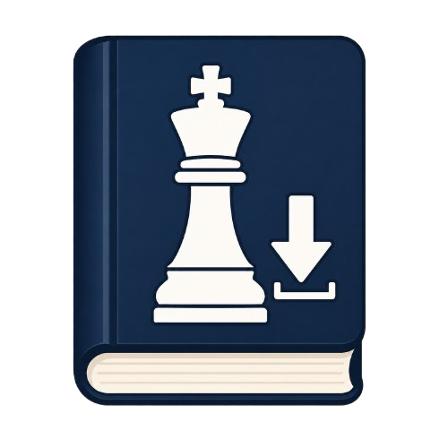

  

<h1 align="center">Chess Book Diagram Extractor</h1>

  Extraia automaticamente diagramas 8×8 de livros de xadrez em PDF.

  

O **Chess Book Diagram Extractor** é um aplicativo gratuito para Windows que
localiza automaticamente diagramas de tabuleiros em livros de xadrez. Ele gera
um novo PDF A4 com um diagrama centralizado por página, pronto para imprimir,
organizar ou estudar.

## Principais recursos

- Detecta páginas com zero, um ou vários diagramas.
- Recorta as 64 casas, as peças e a borda imediata do tabuleiro.
- Corrige pequenas inclinações e elimina detecções duplicadas.
- Filtra ilustrações, peças isoladas e outros falsos positivos comuns.
- Preserva a ordem em que os diagramas aparecem no livro.
- Cria um PDF A4 branco com um diagrama centralizado por página.
- Informa abaixo de cada diagrama a página original e a confiança da detecção.
- Exige evidência de grade 8×8 para rejeitar textos, retratos, mapas e
  ilustrações aproximadamente quadradas.
- Sugere localmente a posição das peças em notação Forsyth portuguesa.
- Combina três modelos locais para eleger a peça de cada casa e indica casas
  com reconhecimento incerto quando os modelos discordam.
- Permite escolher a notação das peças em português ou inglês.
- Permite visualizar e, opcionalmente, editar as posições antes de salvar no PDF.
- Compara casas ambíguas com peças confiáveis encontradas no mesmo livro,
  sempre respeitando a cor clara ou escura da casa.
- Aprende com edições feitas na notação daquele PDF e preserva essas referências
  localmente para execuções futuras.
- Permite marcar um recorte como **Não é um tabuleiro/diagrama**, removendo-o do
  PDF revisado e da lista final de posições.
- Salva automaticamente um rascunho da revisão para continuar depois.
- Salva o livro na biblioteca assim que o reconhecimento termina, antes da
  revisão, com contagens de diagramas **OK** e **Ajustar / conferir**.
- Permite editar por clique ou arrastar peças e vazio para o tabuleiro, com
  borda azul na casa selecionada e indicador durante a revisão em segundo plano.
- Trata pequenas bolinhas pretas indicativas como casas vazias.
- Mantém uma biblioteca interna dos livros processados, independente da cópia
  de PDF exportada, para reabrir e editar as posições posteriormente.
- Permite definir o lado a jogar e o `Annotator` e exportar uma entrada PGN por
  diagrama, com as tags `SetUp` e `FEN` (posição e lado a jogar).
- Mostra original e reconstrução pela Forsyth lado a lado, com peças clássicas
  pretas e brancas, posição completa abaixo e botão para copiar.
- Oculta recortes sem tabuleiro dos livros antigos da biblioteca e permite
  mostrar os descartados para restaurar uma classificação manualmente.
- Exporta uma cópia do livro com diagramas padronizados, preservando páginas,
  texto e o restante do PDF original.
- Permite cancelar com segurança a detecção, o reconhecimento ou a geração do PDF.
- Verifica novas versões e valida o SHA-256 antes de atualizar.
- Reabre automaticamente depois de uma atualização iniciada pelo aplicativo.
- Inclui desinstalador e não exige Python ou bibliotecas adicionais.

## Baixar e instalar

Consulte as [notas da v0.4.1](docs/RELEASE_NOTES_v0.4.1.md) para as melhorias
de edição, reconhecimento e retomada da revisão.

1. Clique no botão **Baixar para Windows** no início desta página.
2. Execute `ChessBookDiagramExtractor-Setup.exe`.
3. Siga as instruções do instalador.
4. Abra **Chess Book Diagram Extractor** pelo menu Iniciar.

O aplicativo é compatível com Windows 10 e Windows 11 de 64 bits e é instalado
somente para o usuário atual.

> Enquanto o projeto não possuir um certificado de assinatura de código, o
> Windows SmartScreen poderá mostrar um aviso na primeira execução do
> instalador.

## Como usar

1. Clique em **Selecionar PDF** e escolha o livro.
2. O aplicativo sugere automaticamente um arquivo com o sufixo `_diagramas.pdf`.
3. Se necessário, clique em **Alterar** para escolher outro local de saída.
4. Mantenha **Incluir notação Forsyth** marcada para reconhecer a posição das
   peças, ou desmarque-a para usar o fluxo simples.
5. Escolha se a notação das peças será em **Português** ou **Inglês**.
6. Marque ou desmarque **Abrir o PDF ao concluir**.
7. Clique em **Extrair diagramas**. O PDF das extrações é salvo primeiro.
8. Se a notação estiver ativa, o aplicativo relê esse PDF e abre a janela de
   visualização. O livro já fica salvo na biblioteca, mesmo se você fechar a
   revisão antes de exportar. Use **Primeiro**, **Anterior**, **Próximo** e **Último** para navegar.
9. Confira os avisos de revisão automática. Se um recorte não for um tabuleiro,
   marque a opção correspondente para excluí-lo do resultado final.
10. Clique em **Salvar notações no PDF**. A posição com `w/b` aparecerá como
    texto selecionável abaixo do diagrama, e as posições também serão listadas ao final.
11. Ao terminar, use **Abrir PDF** ou **Abrir pasta**.
12. Para voltar a um livro, selecione-o na biblioteca abaixo de **Extrair
    diagramas** e clique em **Visualizar selecionado**. No visualizador, escolha
    **Brancas** ou **Pretas** em **Lado a jogar**, revise as posições e use **Exportar
    PGN** quando desejar. Posições inválidas são omitidas sem bloquear as
    válidas, e o nome do `Annotator` será solicitado durante a exportação.
13. Para conferir a reconstrução, use **Lado a lado**, **Original** ou **Padronizado**.
    Clique em uma casa reconstruída para escolher qualquer peça branca,
    preta ou **Casa vazia**. A Forsyth completa é atualizada abaixo do diagrama.
    Também é possível arrastar uma peça ou vazio da paleta para a casa desejada;
    uma borda azul indica a seleção. A reavaliação do livro acontece em segundo
    plano, com um pequeno indicador de progresso.
    Colocar um rei move o rei da mesma cor; posições sem os dois reis continuam
    sinalizadas. Na biblioteca, **Por linhas** oferece a edição textual avançada.
14. Use **Exportar livro padronizado** para salvar uma cópia do livro com os
    novos diagramas nos mesmos lugares. Posições inválidas, recortes excluídos
    e localizações não confirmadas permanecem como no original; o resultado
    informa quantos foram mantidos. Em livros antigos da biblioteca, selecione
    o PDF original quando solicitado para localizar os diagramas novamente.

**Exportar PGN** está disponível também durante a revisão inicial. Avisos de
reconhecimento não bloqueiam a exportação; posições inválidas são omitidas e
informadas ao final. A mensagem “Possível falso positivo” não é impressa no PDF.

Na biblioteca, **Mostrar recortes descartados** permite conferir os recortes
ocultos pelo filtro. Desmarque **Não é um tabuleiro — descartar** para restaurar
um diagrama. A escolha fica salva sem apagar a imagem ou a posição anterior.

A lista mostra **Diagramas**, **OK** e **Ajustar / conferir** (sem contar recortes
descartados). Exigem revisão as notações inválidas e os reconhecimentos incertos.
Depois de comparar as peças, use **Confirmar diagrama conferido** se tudo estiver
certo, ou corrija as casas. O trabalho fica salvo para reabrir sem reconhecer o
livro novamente. **OK** indica validação e confiança ou conferência manual;
não garante que toda peça reconhecida automaticamente esteja correta.

**Reavaliar imagem** reconhece novamente o recorte atual, incluindo em livros
antigos. Isso substitui a posição atual pelo novo reconhecimento e mantém o lado
a jogar. Bordas com coordenadas são alinhadas antes de dividir as 64 casas.
Quando os modelos reconhecem reis duplicados ou deixam de encontrar um rei,
o aplicativo elege exatamente um de cada cor com base nas probabilidades,
mantendo avisos nas casas ajustadas para conferência.

Na biblioteca, use **Renomear** para alterar o nome interno e **Excluir** para
remover apenas a cópia permanente do aplicativo. `F2`, `Delete` e `Enter`
acionam, respectivamente, renomear, excluir e visualizar. Se uma extração ou
renomeação repetir o nome de outro livro, o aplicativo solicita confirmação
antes de substituir o conjunto de diagramas existente.

O PDF escolhido durante a extração é uma cópia exportada. A biblioteca mantém
uma cópia interna própria, portanto o livro continua disponível no aplicativo
mesmo que o arquivo exportado seja movido ou excluído.

Na notação portuguesa, `R/D/T/B/C/P` representam rei, dama, torre, bispo,
cavalo e peão brancos. Na opção inglesa, são usadas as letras tradicionais
`K/Q/R/B/N/P`. Em ambos os casos, letras minúsculas representam as peças pretas. A
sugestão é automática e pode errar em diagramas antigos ou degradados, por isso
o aplicativo sempre oferece a visualização antes de gerar o documento anotado.

O livro original nunca é alterado.

## Atualizações automáticas

Ao iniciar, o aplicativo consulta a versão mais recente publicada neste
repositório. Quando houver uma atualização, ele solicita confirmação antes de
baixar e instalar qualquer arquivo. O instalador baixado só é executado após a
validação de seu hash SHA-256.

Depois de iniciar o instalador, o aplicativo fecha e reabre automaticamente
quando a atualização termina.

Também é possível abrir o menu no canto superior direito e escolher
**Verificar atualizações**.

## Como desinstalar

Use uma destas opções do Windows:

- abra **Desinstalar Chess Book Diagram Extractor** no menu Iniciar; ou
- acesse **Configurações > Aplicativos > Aplicativos instalados**.

O Editor exibido pelo Windows é **E-Lopes**.

## Segurança e privacidade

O processamento dos livros acontece localmente no computador. O arquivo PDF
não é enviado para servidores externos. O reconhecimento Forsyth também usa
um modelo incluído no aplicativo e funciona localmente. A internet é usada
somente para verificar e baixar atualizações.

Consulte a [Política de Privacidade](PRIVACY.md) e a
[Política de assinatura de código](CODE_SIGNING_POLICY.md).

O projeto solicitou a assinatura gratuita fornecida por
[SignPath.io](https://signpath.io/), com certificado da
[SignPath Foundation](https://signpath.org/). Versões publicadas antes da
conclusão dessa integração podem não possuir assinatura digital.

> Free code signing provided by SignPath.io, certificate by SignPath Foundation.

## Limitações conhecidas

A detecção visual foi desenvolvida para tabuleiros convencionais 8×8 com
resolução legível. Diagramas muito degradados ou elementos gráficos que imitam
fortemente uma grade 8×8 ainda podem produzir falsos positivos.

O reconhecimento de posições usa o modelo do projeto
[fenshot](https://github.com/scoriiu/fenshot), distribuído sob a licença MIT.
Consulte os [avisos de terceiros](THIRD_PARTY_NOTICES.md).

## Documentação técnica

Para entender a arquitetura, os algoritmos de detecção e Forsyth, o processo de
distribuição no Windows, os testes e os motivos das principais escolhas,
consulte a [documentação técnica do projeto](docs/README.md).

---

  Desenvolvido e publicado por <strong>E-Lopes</strong> · Licença MIT

